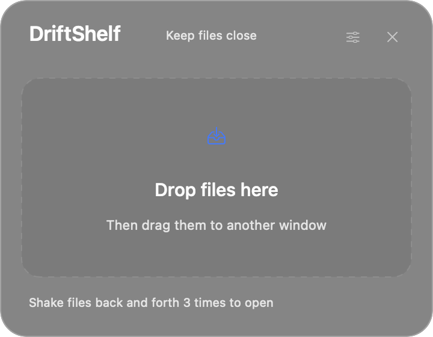
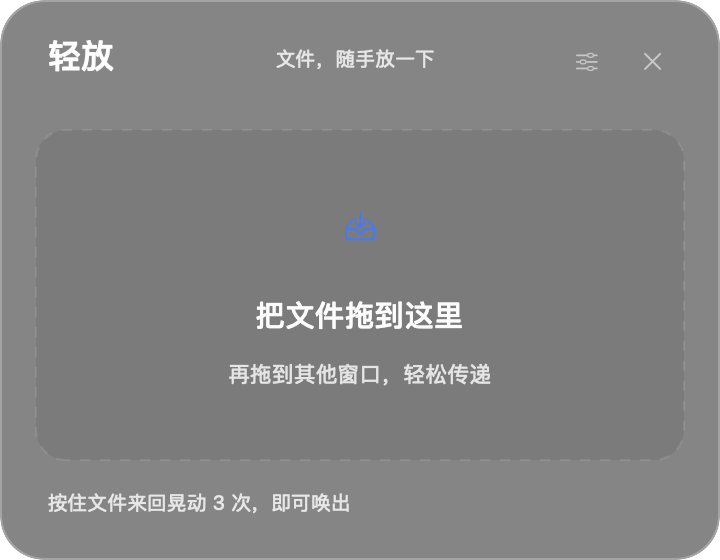

# DriftShelf · 轻放

A small native macOS shelf for files you are dragging between windows.
Drag files in Finder, shake three times, drop them onto the shelf, then take them to another app.

原生 macOS 文件暂存工具。拖着 Finder 文件晃动三次，放入浮动窗口，再拖到其他应用。

[English](#english) · [简体中文](#简体中文) · [MIT License](LICENSE)

| English | 简体中文 |
| --- | --- |
|  |  |

## English

### Features

- Shake files back and forth three times to reveal a floating shelf near the pointer.
- Collect files and folders, remove duplicates, and drag out one item or the whole group.
- Hide the window while keeping its contents. It hides automatically after the last successful export.
- Native glass background with saved transparency settings, light/dark appearance, and a menu bar icon.
- Switch between **English**, **简体中文**, and **System Default** from **Language / 语言** in the menu bar. The interface updates immediately and remembers your choice.
- No third-party dependencies, account login, telemetry, or file uploads.

### Requirements

- macOS **13 Ventura or later**.
- Apple Silicon (`arm64`) or Intel (`x86_64`) Mac. The script builds for the architecture of the terminal running it. Use a native terminal on Apple Silicon rather than a terminal running under Rosetta.
- Apple's **Xcode Command Line Tools** with Swift and the macOS SDK. Full Xcode also works, but is optional.

**No paid Apple Developer Program membership, signing certificate, or Apple account login is needed by these build scripts.** They compile with `swiftc` and apply a local ad-hoc signature (`codesign --sign -`). The app is not Developer ID signed or notarized.

### Build and run from source

1. Open **Terminal** and install Apple's tools if needed:

   ```sh
   xcode-select --install
   ```

   Finish the installation dialog before continuing. If the tools are already installed, skip this step. See [Apple's installation guide](https://developer.apple.com/documentation/xcode/installing-the-command-line-tools).

2. Download the source:

   ```sh
   git clone https://github.com/lokiwizard/DriftShelf.git
   cd DriftShelf
   ```

   Alternatively, choose **Code → Download ZIP** on GitHub, extract it, type `cd ` in Terminal, drag the extracted folder into Terminal, and press Return.

3. Build and launch:

   ```sh
   bash scripts/build.sh
   open build/DriftShelf.app
   ```

   The script runs gesture and localization tests, builds the `.app`, copies both translations and the icon, and verifies its local signature. The app appears in the **menu bar**, without a Dock icon. A floating window opens on the first launch.

4. Optional: quit the app from its menu bar, then copy `build/DriftShelf.app` into your **Applications** folder in Finder. Open that copy for everyday use. Before rebuilding or replacing an installed copy, quit the running app.

Finder's app name follows the system language; the language menu controls the running app's interface. The application bundle and executable paths always remain `DriftShelf.app` and `DriftShelf`.

### Use

1. Start dragging files or folders in Finder.
2. Shake horizontally or vertically three times in about two seconds. Drop onto the shelf that appears near the pointer.
3. Drag a file row to another Finder window or an app that accepts files. Drag the **bottom area** of the shelf to take all items.
4. Click **×** to hide the window and retain the list. Use the tray icon in the menu bar to show it, clear it, change language, adjust appearance, or quit.

The shelf stores **file references**; adding, clearing, hiding, and quitting do not copy, move, or delete originals. When you drag out, the **destination** decides whether to copy or move the files. Hold **Option** when dropping in Finder to request a copy. Cancelled exports keep the items on the shelf.

### Optional checks and packaging

Build-time tests run automatically. GitHub Actions also builds and runs them on Apple Silicon and Intel runners. Native AppKit integration checks remain local and need a logged-in macOS graphical session:

```sh
build/DriftShelf.app/Contents/MacOS/DriftShelf --self-test
```

These checks cover native pasteboards and simulated drag callbacks, single-instance protection, export visibility, glass rendering, and language switching with existing files and open settings. They do not automate actual Finder gestures, hardware haptics, multiple displays, or Space/fullscreen transitions; check those manually on your Mac.

To create a locally signed disk image for the selected architecture:

```sh
bash scripts/package.sh
```

Output: `dist/DriftShelf-1.1.0-arm64.dmg` or `dist/DriftShelf-1.1.0-x86_64.dmg`, plus a `.sha256` checksum file. Packaging verifies the image with `hdiutil verify`. A DMG does not add Developer ID signing or notarization. Source compilation is the recommended way to get the app.

For an explicit compile target, use `ARCH=arm64 bash scripts/build.sh` or `ARCH=x86_64 bash scripts/build.sh`. Cross-compilation alone does not verify runtime behavior on the other architecture. To regenerate the included icon, run `bash scripts/make-icon.sh`.

### Troubleshooting

- **Xcode license / invalid developer directory:** If full Xcode is selected but unfinished, open it and complete Apple's setup. If standalone Command Line Tools are installed, the script can fall back to them without changing the system setting. To select them for this terminal session, run `export DEVELOPER_DIR=/Library/Developer/CommandLineTools` before building; only use this path when it exists.
- **macOS blocks the app:** After checking the source and attempting to open it, follow **System Settings → Privacy & Security → Open Anyway** if macOS offers that option. See [Apple's instructions](https://support.apple.com/en-us/102445). The steps do not disable Gatekeeper or remove quarantine attributes.
- **No Dock icon:** This is a menu bar app. Look for the tray icon at the top of the screen and choose **Show Shelf**.
- **An older copy opens instead:** Quit all running copies of DriftShelf / 轻放 from the menu bar and launch your new build. The app keeps the earlier version's bundle identifier (`com.loki.qingfang`) to preserve preferences and prevent two copies running together.
- **Shaking does not open the shelf:** Start with an existing Finder file, hold the mouse button, and make deliberate movements. You can also use **Show Shelf** from the menu bar.

### Limits and privacy

- Only existing file URLs are supported, including folders and files on mounted volumes. Unsaved mail attachments and other file promises are not supported.
- The shelf is not saved across app restarts. A file moved or deleted elsewhere must be dragged in again.
- The app samples pointer position, left-button state, and the system drag pasteboard at 60 Hz. It does not monitor keyboard input or request Accessibility permission.
- Haptic feedback requires a compatible trackpad; an ordinary mouse cannot provide it. Glass rendering follows macOS's **Reduce transparency** setting.
- The app itself has no network functionality. Your destination app or a mounted network volume may perform its own transfers.

### Development and license

`Sources/` contains the AppKit app, localization helper, and gesture detector. `assets/en.lproj/` and `assets/zh-Hans.lproj/` hold UI translations. `Tests/` contains gesture and localization checks. `scripts/` builds the app, packages a DMG, and regenerates the icon.

Changes can be proposed through issues or pull requests. Include your macOS version, Mac architecture, and reproduction steps for bug reports. Licensed under [MIT](LICENSE).

## 简体中文

### 功能

- 拖着文件来回晃动三次，在指针附近唤出浮动暂存窗口。
- 支持文件、文件夹、多项暂存、去重、单项拖出和整组拖出。
- 隐藏窗口时保留列表，最后一项成功拖出后自动隐藏。
- 原生毛玻璃背景，可调节并保存透明度，支持浅色与深色外观，驻留菜单栏。
- 菜单栏 **Language / 语言** 可选择 **English**、**简体中文**或**跟随系统**，立即生效并保存选择。
- 无第三方依赖，不需要登录，不收集遥测数据，不上传文件。

### 环境要求

- **macOS 13 Ventura 或更高版本**。
- Apple Silicon（`arm64`）或 Intel（`x86_64`）Mac。脚本按运行终端的架构编译；Apple Silicon 请使用原生终端，避免通过 Rosetta 运行终端。
- 苹果 **Xcode Command Line Tools**，包含 Swift 编译器和 macOS SDK。完整 Xcode 也可使用，但不是必需。

**这些构建脚本不需要付费加入苹果开发者计划，不需要签名证书，也不需要登录 Apple 账号。** 脚本使用 `swiftc` 编译，并通过 `codesign --sign -` 添加本机 ad-hoc 签名。应用没有 Developer ID 签名或 Apple 公证。

### 从源码编译运行

1. 打开 macOS 的**终端**。若尚未安装苹果命令行工具，执行：

   ```sh
   xcode-select --install
   ```

   等安装窗口完成后再继续；已安装则跳过。参考[苹果安装说明](https://developer.apple.com/documentation/xcode/installing-the-command-line-tools)。

2. 下载源码：

   ```sh
   git clone https://github.com/lokiwizard/DriftShelf.git
   cd DriftShelf
   ```

   也可以在 GitHub 选择 **Code → Download ZIP**，解压后在终端输入 `cd `，把解压文件夹拖入终端，再按回车。

3. 编译并启动：

   ```sh
   bash scripts/build.sh
   open build/DriftShelf.app
   ```

   脚本会运行晃动识别和语言测试，构建 `.app`，复制中英文资源及图标，并校验本机签名。启动后图标位于屏幕顶部的**菜单栏**，没有 Dock 图标；首次启动会显示暂存窗口。

4. 可选：从菜单栏退出应用，在 Finder 中把 `build/DriftShelf.app` 复制到**应用程序**文件夹，再打开该副本供日常使用。重新编译或替换安装副本前，请先退出正在运行的应用。

Finder 中显示的应用名称跟随系统语言；应用内语言菜单控制运行界面。应用包和可执行文件路径始终使用 `DriftShelf.app` 和 `DriftShelf`。

### 使用

1. 在 Finder 中按住并拖动文件或文件夹。
2. 在约两秒内水平或垂直来回晃动三次，将文件放入指针附近出现的窗口。
3. 拖动文件行，可把单个文件交给其他 Finder 窗口或支持文件拖放的应用。拖动**窗口底部空白处**可一次带走全部。
4. 点击 **×** 只隐藏窗口并保留列表。菜单栏托盘图标可显示窗口、清空列表、切换语言、调节外观或退出。

暂存区只保存**文件引用**。放入、清空、隐藏和退出不执行原文件的复制、移动或删除。拖出时由**接收方**决定复制还是移动；在 Finder 中按住 **Option** 放下可请求复制。取消拖出则保留暂存条目。

### 可选检查与打包

构建时自动运行基础测试，GitHub Actions 也会在 Apple Silicon 和 Intel 环境中构建并运行这些测试。AppKit 图形集成检查在本地执行，需要已登录的 macOS 图形会话：

```sh
build/DriftShelf.app/Contents/MacOS/DriftShelf --self-test
```

检查覆盖原生粘贴板与模拟拖放回调、单实例保护、拖出后的窗口状态、毛玻璃渲染，以及已有文件和打开设置窗口时的语言切换。真实 Finder 手势、硬件触觉、多显示器和 Space／全屏切换仍需在目标机器上手动验证。

如需打包对应架构的本机签名磁盘映像：

```sh
bash scripts/package.sh
```

输出为 `dist/DriftShelf-1.1.0-arm64.dmg` 或 `dist/DriftShelf-1.1.0-x86_64.dmg`，附带 `.sha256` 校验文件。脚本使用 `hdiutil verify` 校验映像。打包不会添加 Developer ID 签名或公证，推荐通过源码编译获取应用。

可用 `ARCH=arm64 bash scripts/build.sh` 或 `ARCH=x86_64 bash scripts/build.sh` 指定编译目标。交叉编译不代表已经验证另一架构的实际运行。重新生成仓库内图标可运行 `bash scripts/make-icon.sh`。

### 常见问题

- **提示 Xcode 许可未接受或开发工具路径无效：** 若使用完整 Xcode，请先打开并完成苹果要求的首次设置。安装了独立 Command Line Tools 时，脚本可自动回退，不修改系统设置。也可在确认该目录存在后，先执行 `export DEVELOPER_DIR=/Library/Developer/CommandLineTools`，仅对当前终端生效。
- **macOS 阻止启动：** 确认源码后先尝试打开，再按系统提示进入**系统设置 → 隐私与安全性 → 仍要打开**。参考[苹果说明](https://support.apple.com/en-us/102445)。操作不需要关闭 Gatekeeper 或删除隔离属性。
- **Dock 中没有图标：** 应用驻留菜单栏，点击屏幕顶部的托盘图标，选择**显示暂存窗口**。
- **启动后显示旧版：** 从菜单栏退出所有 DriftShelf／轻放副本，再打开新构建。项目保留旧版 bundle identifier（`com.loki.qingfang`），以沿用偏好设置并防止多个副本同时运行。
- **晃动没有唤出窗口：** 先拖动 Finder 中已存在的文件，保持鼠标按下并进行明显的往返运动；也可从菜单栏手动显示窗口。

### 边界与隐私

- 只接收已存在文件的 URL，包括文件夹和已挂载磁盘中的文件；不支持尚未落盘的邮件附件等文件承诺。
- 暂存列表不跨重启保存，原文件被移动或删除后需要重新拖入。
- 应用以 60 Hz 采样指针位置、鼠标左键状态和系统拖拽粘贴板，不监听键盘，不要求辅助功能权限。
- 触觉反馈需要支持的触控板，普通鼠标无法提供；毛玻璃遵循 macOS 的**减少透明度**设置。
- 应用自身没有网络功能，接收文件的应用或挂载的网络磁盘可能执行自身的数据传输。

### 开发与许可证

`Sources/` 包含 AppKit 应用、语言辅助代码和晃动检测器；`assets/en.lproj/` 与 `assets/zh-Hans.lproj/` 为界面翻译；`Tests/` 包含晃动和语言测试；`scripts/` 提供应用构建、DMG 打包和图标生成。

欢迎通过 issue 或 pull request 提出修改。报告问题时请附 macOS 版本、Mac 架构和复现步骤。代码采用 [MIT 许可证](LICENSE)。
